<p><picture><source media="(max-width: 600px)" srcset="assets/readme/hero-mobile.svg"/>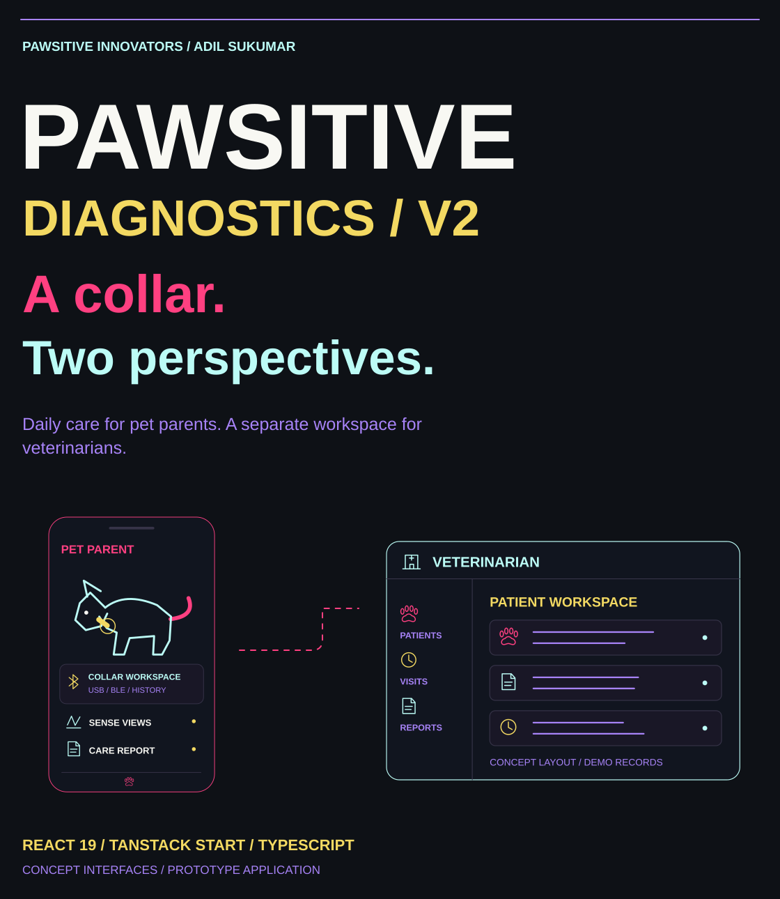</picture></p>

<p align="center"><a href="#the-second-workspace">Overview</a> · <a href="#explore-the-application">Explore</a> · <a href="#inside-the-collar-connection">Collar</a> · <a href="#artificial-intelligence-and-services">Services</a> · <a href="#run-locally">Setup</a> · <a href="#explore-the-source">Source</a></p>

<p><picture><source media="(max-width: 600px)" srcset="assets/readme/section-overview-mobile.svg"/>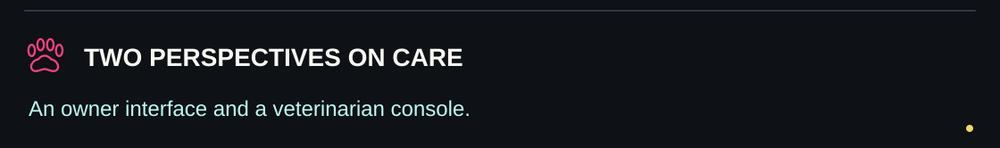</picture></p>

## The second workspace

**Pawsitive Diagnostics V2** brings two interfaces into one application: a mobile care workspace for pet parents and a veterinarian console for patient-oriented workflows. I built this iteration around the connection between collar readings, everyday care and the information someone needs when opening a report.

The current repository includes dog profiles, Sense interfaces, USB/Bluetooth transport code, location and clinic views, community interactions, report exports, translation and avatar-generation helpers. It uses **React 19, TypeScript and TanStack Start**.

[Open the deployed application](https://pawsitive-diagnostics-v2.vercel.app) · [V1 repository](https://github.com/adilsukumar/Pawsitive-Diagnostics-V1) · [Roadmap](roadmap.md)

This is a prototype: several flows use local or simulated data. The implementation notes below explain how to interpret those paths.


<p><picture><source media="(max-width: 600px)" srcset="assets/readme/section-features-mobile.svg"/>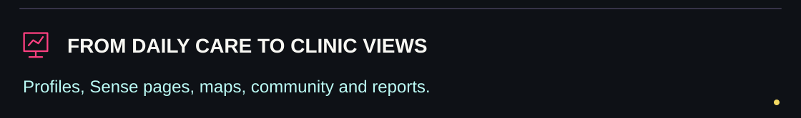</picture></p>

## Explore the application

<p><picture><source media="(max-width: 600px)" srcset="assets/readme/features-mobile.svg"/>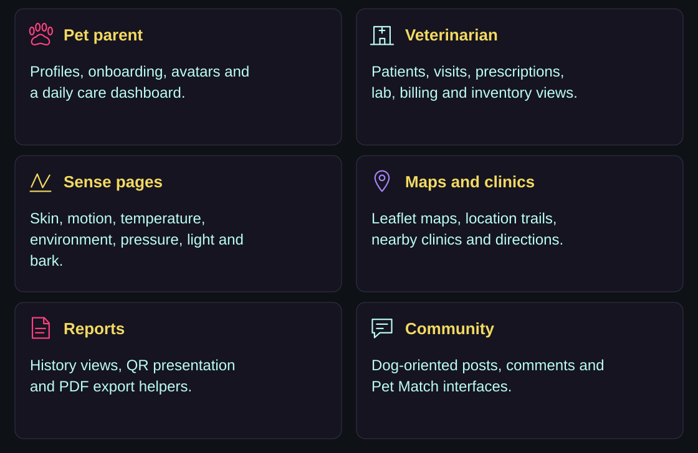</picture></p>

| Workspace | What you can explore |
|---|---|
| Pet parent | Guest entry, local sign-in, owner/dog onboarding, avatar customization, profile and dashboard |
| Sense views | Skin, bark, motion, temperature, environment, pressure and light pages |
| Map and clinics | Leaflet map, trail presentation, safe-zone/lost-mode controls, nearby clinic lookup and directions |
| Reports | Browser-stored sensor history, period filters, QR presentation and PDF export |
| Community | Dog-oriented sample posts, reactions, comments, composition and Pet Match |
| Veterinarian | Patient list/detail, appointments, consultations, prescriptions, vaccinations, lab, reports, billing and inventory interfaces |
| Preferences | Language catalogue, translation helper, appearance and account settings |

The general assistant at [`/ai`](src/routes/ai.tsx) uses intent handling and prepared response components. Skin analysis and its follow-up chat use a separate Gemini helper. They are different implementations.


<p><picture><source media="(max-width: 600px)" srcset="assets/readme/section-collar-mobile.svg"/>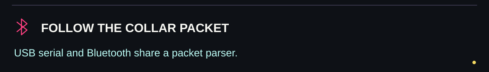</picture></p>

## Inside the collar connection

<p><picture><source media="(max-width: 600px)" srcset="assets/readme/connection-mobile.svg"/>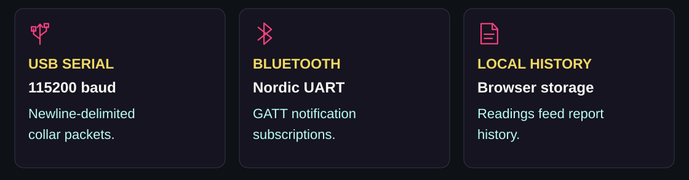</picture></p>

The shared [`CollarContext`](src/context/CollarContext.tsx) implements two connection paths:

- **USB serial:** requests an ESP32-compatible port, opens it at **115200 baud**, buffers text and processes complete newline-delimited packets.
- **Web Bluetooth:** connects to the **Nordic UART Service**, subscribes to TX notifications and optionally reads the standard battery characteristic.

Both paths accept JSON or supported `key:value` lines. The sensor keys are `skin`, `motion`, `temp`, `humidity`, `pressure` and `light`; aliases include `temp_c`, `humidity_rh` and `motion_mps2`. Example transport packet:

```json
{"temp": 32.1, "humidity": 45, "motion": 0.3, "pressure": 101.3, "light": 300, "battery": 78}
```

These are illustrative transport values, not a reference animal-health result. Use matching firmware and a browser/device combination that provides the required API. Nearby-clinic and map features separately request location permission.

**Current demo behavior:** the context initializes with sample values and a connected/receiving state, includes timed value fluctuations and a keyboard-triggered pressure demo. A connected badge or changing chart therefore does not, by itself, establish a physical-device reading. [`sensorHistory.ts`](src/lib/sensorHistory.ts) also receives those updates.


<p><picture><source media="(max-width: 600px)" srcset="assets/readme/section-services-mobile.svg"/>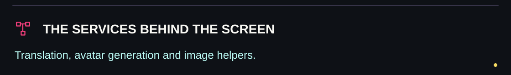</picture></p>

## Artificial Intelligence and services

| Service | Configuration | Current behavior |
|---|---|---|
| UI translation | Server-only `AI_API_URL`, `AI_API_KEY`, `AI_MODEL` | OpenAI-compatible chat request; returns the original strings when no key is supplied or the request fails |
| Avatar illustrations | Server-only `REPLICATE_API_KEY` | Background removal followed by image-to-image illustration generation |
| Skin image analysis, skin chat and breed insights | `VITE_GEMINI_API_KEY` in the current browser-side helper | Source requests `gemini-3.5-flash`; provider/model availability has not been verified for this documentation update |
| Nearby clinics | Browser location + Overpass endpoints | Looks up OpenStreetMap veterinary features; results depend on service coverage and availability |
| Maps | Leaflet + map-tile services | Includes a sample trail alongside location-based history |

Translation and avatar secrets stay in server handlers. The existing Gemini helper reads a `VITE_` variable, which exposes its value in the browser build; that integration needs a server-side boundary before using a private provider key in a public deployment. The README update does not change this code.

The language catalogue contains **41 entries** (22 Indian-language entries and 19 global entries). Its count is computed by the application; an adjacent source comment says 43. Translation coverage still depends on the configured service.


<p><picture><source media="(max-width: 600px)" srcset="assets/readme/section-setup-mobile.svg"/>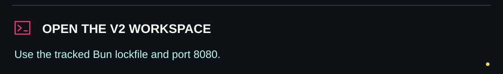</picture></p>

## Run locally

The repository tracks `bun.lock`. From a terminal:

```bash
git clone https://github.com/adilsukumar/Pawsitive-Diagnostics-V2.git
cd Pawsitive-Diagnostics-V2
bun install --frozen-lockfile
```

Copy `.env.example` to `.env.local`. The optional server values are:

```dotenv
AI_API_URL=https://api.openai.com/v1/chat/completions
AI_API_KEY=
AI_MODEL=gpt-4o-mini
REPLICATE_API_KEY=
```

The skin-analysis helper additionally reads `VITE_GEMINI_API_KEY`; it is absent from the example file. See the browser-exposure note above before configuring that path.

```bash
bun run dev
```

Open **http://localhost:8080**. The Vite configuration uses a strict port, so free port 8080 if it is occupied.

| Command | Purpose |
|---|---|
| `bun run dev` | Development server |
| `bun run build` | Production build |
| `bun run build:dev` | Build with development mode |
| `bun run preview` | Preview build output |
| `bun run lint` | ESLint checks |
| `bun run format` | Rewrite formatting with Prettier |

No `test` script is declared in the current package file. The stack includes Tailwind CSS 4, Radix/shadcn components, Recharts, Framer Motion, Leaflet, jsPDF and QR components.


<p><picture><source media="(max-width: 600px)" srcset="assets/readme/section-scope-mobile.svg"/>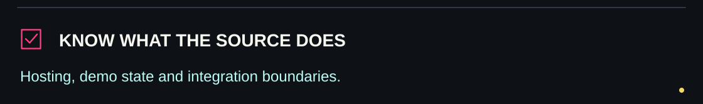</picture></p>

## Deployment and current scope

The repository's [`vercel.json`](vercel.json) selects **TanStack Start**. Its Vite build includes Nitro. To deploy, import the repository at its root, retain the detected framework and default build settings, and configure optional server-side environment values in the hosting project. The original deployment instructions use `bun run build` (or `npm run build`) without an output-directory override.

| Area | Current source scope |
|---|---|
| Accounts | Browser `localStorage` stores account records, including passwords; this is a local demo sign-in flow, not production authentication |
| Clinic console | Bundled patient and clinical interface data; no claim of a connected hospital records backend |
| Community | Seeded posts and in-page interactions; no shared community service established by those views |
| BarkSense | Keyboard-selected emotion states and a generated visualizer; it is not a demonstrated audio classifier |
| Device readings | USB/BLE parsing exists alongside seeded values, timed fluctuations and a pressure demo |
| Light control | Hook contains literal `${endpoint}` request strings rather than interpolated URLs; remote light-control requests need a separate code correction |
| Scores and advice | Presentation/heuristic or generated outputs, with no diagnostic validation established by this repository |

The historical README was a WanCare/Japan-oriented screen specification. It remains available as the [original planning brief](https://github.com/adilsukumar/Pawsitive-Diagnostics-V2/blob/a8c7f668b0a43243dfdfea4182167c95aedb3fb2/README.md). This README describes the current Pawsitive source, which also contains Indian/localized content and a veterinarian workspace.


<p><picture><source media="(max-width: 600px)" srcset="assets/readme/section-source-mobile.svg"/>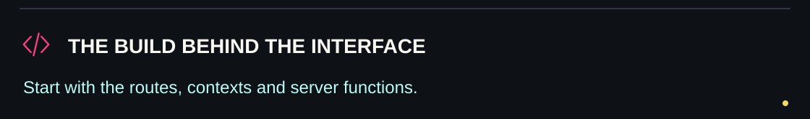</picture></p>

## Explore the source

<p align="center"><a href="src/context/AuthContext.tsx">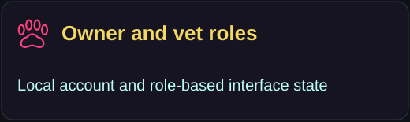</a> <a href="src/context/CollarContext.tsx">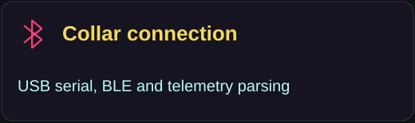</a> <a href="src/routes/report.tsx">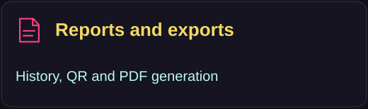</a> <a href="src/lib/translate.functions.ts">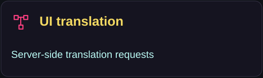</a> <a href="src/lib/avatar.functions.ts">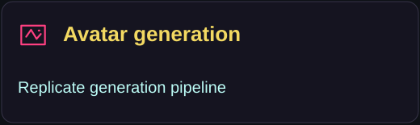</a> <a href="src/routes/">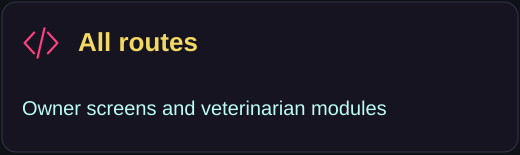</a></p>

| Start here | What it contains |
|---|---|
| [src/routes/](src/routes/) | Owner, onboarding, Sense and veterinarian routes |
| [AuthContext.tsx](src/context/AuthContext.tsx) · [PetContext.tsx](src/context/PetContext.tsx) | Local role/session and dog-profile state |
| [CollarContext.tsx](src/context/CollarContext.tsx) | Serial/Bluetooth connection, parsing and demo state |
| [sensorHistory.ts](src/lib/sensorHistory.ts) · [telemetryInterpretation.ts](src/lib/telemetryInterpretation.ts) | Browser history and interpretation helpers |
| [vetData.ts](src/components/vet/vetData.ts) | Bundled veterinarian workspace records |
| [translate.functions.ts](src/lib/translate.functions.ts) · [avatar.functions.ts](src/lib/avatar.functions.ts) | Optional server-side providers |
| [gemini.ts](src/lib/gemini.ts) · [chatResponses.ts](src/utils/chatResponses.ts) | Separate provider-backed and intent-based response paths |
| [package.json](package.json) · [vite.config.ts](vite.config.ts) · [roadmap.md](roadmap.md) | Commands, build configuration and project direction |

**Pawsitive Innovators · Adil Sukumar.** Built around the relationship between animals, their people and the technology used to care for them.


<p><picture><source media="(max-width: 600px)" srcset="assets/readme/closing-mobile.svg"/>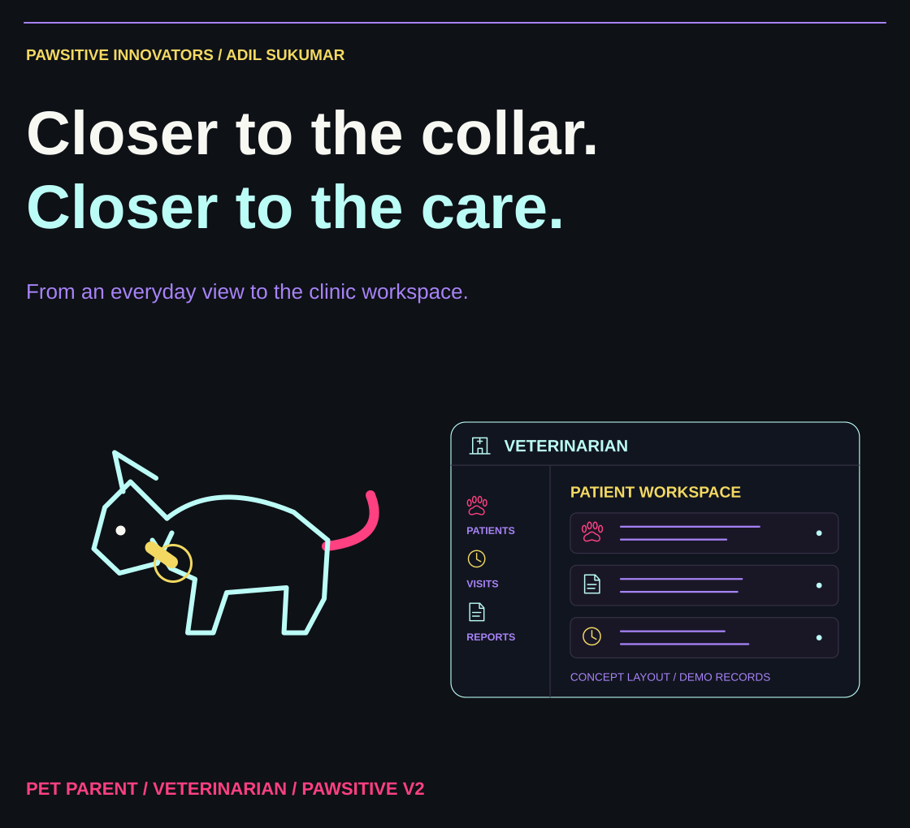</picture></p>
